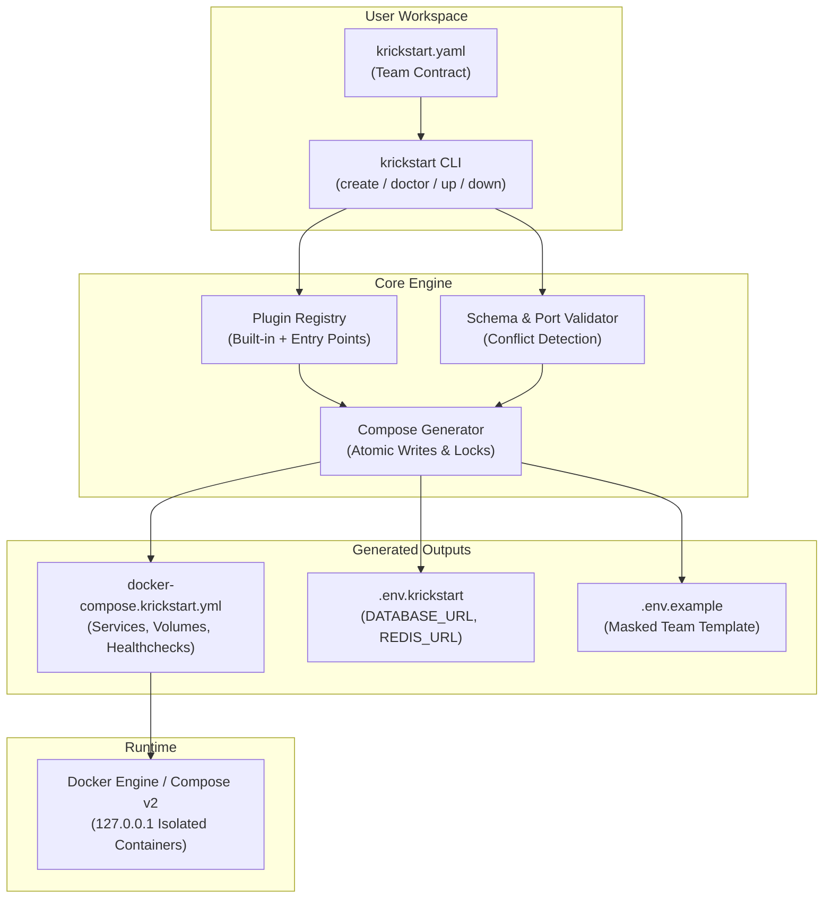

# ⚡ Krickstart 

**Spin up a reproducible local development environment in seconds.**

[](https://github.com/ZitouniNidhal/Krickstart/actions)
[](https://pypi.org/project/krickstart/)
[](LICENSE)
[](https://pypi.org/project/krickstart/)
[](https://github.com/psf/black)
[](https://github.com/astral-sh/ruff)
[](CONTRIBUTING.md)

`krickstart` is an opinionated, high-performance CLI tool that turns a concise `krickstart.yaml` recipe into a fully operational, reproducible Docker Compose environment. It eliminates the "it works on my machine" struggle by automating starter templates, database wiring, environment contracts, and connection URL generation.

**Stop debugging ports, volumes, and health checks. Start building.**

```text
krickstart.yaml  ➔  krickstart up  ➔  🚀 Ready-to-code Stack (App + Database + URLs)
```

---

## 🏛️ Architecture Overview

`krickstart`  sits as a declarative translation layer between your team's configuration contract and Docker Compose



---

## 📊 Krickstart vs. Alternatives

| Capability | ⚡ Krickstart | Docker Compose | VS Code Dev Containers | Tilt | Nix / devenv |
| :--- | :---: | :---: | :---: | :---: | :---: |
| **Instant Starters** | ✅ Built-in Stacks | ❌ Manual Setup | ⚠️ Template repos | ❌ Manual Tiltfile | ⚠️ Custom flake |
| **Configuration Complexity** | 🟢 Low (~15 lines YAML) | 🔴 High (verbose Compose) | 🟡 Medium (`devcontainer.json`) | 🔴 High (Starlark/Tiltfile) | 🔴 High (Nix language) |
| **Auto-Wiring (`.env` / URLs)** | ✅ Automated | ❌ Manual `.env` | ⚠️ Partial | ❌ Manual | ⚠️ Environment vars only |
| **Editor Agnostic** | ✅ Any editor/IDE | ✅ Any editor/IDE | ❌ Optimized for VS Code | ✅ Any editor/IDE | ✅ Any editor/IDE |
| **Learning Curve** | 🚀 2 minutes | ⏳ Days | ⏳ Hours | ⏳ Days (K8s required) | ⏳ Weeks (Nix syntax) |
| **Host Port Conflict Checks** | ✅ `doctor` pre-flight | ❌ Fails on startup | ❌ Manual | ⚠️ Port-forwarding | ❌ Fails on startup |
| **Localhost Isolation (127.0.0.1)** | ✅ Default | ❌ Defaults to `0.0.0.0` | ⚠️ Container internal | ⚠️ Varies | N/A (Host processes) |

---

## 🚀 Quick Start

### Prerequisites
- **Python 3.10+**
- **Docker Desktop** or Docker Engine with Docker Compose v2

### Installation

Install via your preferred Python tool manager:

```bash
# Recommended (isolated CLI application)
pipx install krickstart
# or with uv:
uv tool install krickstart

# Or with standard pip
pip install krickstart
```

### 30-Second Setup

```bash
# 1. Interactively choose a stack (e.g. FastAPI + PostgreSQL)
krickstart create

# 2. Check local environment and port availability
krickstart doctor

# 3. Launch isolated environment
krickstart up
```

### Scripted / CI Workflow

```bash
krickstart init fastapi-postgres --name billing-api
krickstart doctor
krickstart up
```

---

## 📦 Maintained Stacks

All maintained stacks feature health checks, volume persistence, and loopback security (`127.0.0.1` binding):

| Stack | Description | Included Services |
| :--- | :--- | :--- |
| `fastapi-postgres` | Python FastAPI REST API | FastAPI (Python 3.12), PostgreSQL 16 |
| `django-postgres` | Django Web Framework | Django (Python 3.12), PostgreSQL 16 |
| `flask-postgres` | Flask Microframework | Flask, PostgreSQL 16 |
| `node-postgres-redis` | Node.js Express API | Express (Node 22), PostgreSQL 16, Redis 7 |
| `nextjs-postgres` | Next.js App Router | Next.js, PostgreSQL 16 |
| `go-gin-postgres` | Go Gin REST API | Go Gin, PostgreSQL 16 |
| `spring-boot-postgres` | Java Spring Boot | Spring Boot (JDK 21), PostgreSQL 16 |

---

## 🛠️ CLI Command Reference

| Command | Description |
| :--- | :--- |
| `krickstart list` | Show all available stack templates and descriptions |
| `krickstart init <stack>` | Generate `krickstart.yaml` and starter files for a chosen stack |
| `krickstart create` | Interactive terminal wizard to pick and initialize a stack |
| `krickstart validate` | Validate schema and ensure stack plugin can render without errors |
| `krickstart doctor` | Health-check Docker, Compose v2, YAML syntax, and detect port conflicts |
| `krickstart doctor --fix` | Automatically repair missing safe assets (e.g., regenerate `.env.example`) |
| `krickstart up` | Render Compose files and start containers in detached mode |
| `krickstart up --dry-run` | Preview generated YAML and `.env` files without writing or starting Docker |
| `krickstart down` | Gracefully stop containers (preserves database volumes) |
| `krickstart status` | Display container runtime health and port mappings (`docker compose ps`) |
| `krickstart logs [service]` | View or follow service logs (`--follow` supported) |
| `krickstart export` | Export standalone `docker-compose.yml` and `.env` for production or CI |
| `krickstart cleanup` | Stop containers, remove named volumes, and clean up generated files |

---

## 🔒 Security Best Practices

1. **Loopback Isolation (`127.0.0.1`)**: `krickstart` binds container ports to `127.0.0.1` by default rather than `0.0.0.0`, protecting databases and internal APIs from exposure on public Wi-Fi or local networks.
2. **Masked Examples**: Generated `.env.example` templates automatically redact credentials so teammates can safely commit environment templates to git without leaking passwords.
3. **Never Commit Generated Files**:
   Add to your `.gitignore`:
   ```gitignore
   docker-compose.krickstart.yml
   .env.krickstart
   .env
   ```

---

## 🔌 Plugin System & Extensibility

`krickstart` provides an open plugin interface using Python entry points. Organizations can package internal corporate stacks and publish them as private or public packages.

Third-party packages expose plugins via the `krickstart.stacks` entry point group in `pyproject.toml`:

```toml
[project.entry-points."krickstart.stacks"]
company-microservice = "my_company_stacks.microservice:MicroservicePlugin"
```

Plugins implement the `StackPlugin` interface (`name`, `description`, `default_config`, `compose_yaml`, `env_file`, `post_up_hints`). See [docs/plugin-authoring.md](docs/plugin-authoring.md) for complete details.

---

## 🤝 Contributing

We love contributions! Whether it's a new stack template, a bug fix, or documentation improvement, please check out our [CONTRIBUTING.md](CONTRIBUTING.md) and [CODE_OF_CONDUCT.md](CODE_OF_CONDUCT.md).

**Ways to help:**
- 🌟 **Star the repo** to show your support.
- 🐛 **Report bugs** or request features in the Issues tab.
- 🛠️ **Build a plugin** and share your custom stack with the community.
- 📝 **Improve docs** to help other developers get started faster.

## 📖 Guides
For detailed instructions, explore our documentation:
- [🚀 Getting Started](./docs/getting-started.md) - From installation to your first stack.
- [🛠️ Custom Stacks](./docs/custom-stacks.md) - How to extend devspeed with your own templates.
- [🔍 Troubleshooting](./docs/troubleshooting.md) - Solving common Docker and config issues.


```bash
# Run local test suite and quality gates:
python scripts/dev.py check
```
---

## 🐳 Docker

```bash
docker pull ghcr.io/zitouniNidhal/krickstart:latest
docker run --rm ghcr.io/zitouniNidhal/krickstart:latest --help
```
---
## 📄 License

This project is licensed under the [MIT License](LICENSE).


---

## Contributors

Thanks to these wonderful people for contributing to Krickstart!

| | | | | | |
|:---:|:---:|:---:|:---:|:---:|:---:|
| [](https://github.com/strickvl)<br/>[strickvl](https://github.com/strickvl) | [](https://github.com/shreyashankar)<br/>[shreyashankar](https://github.com/shreyashankar) | [](https://github.com/mattpocock)<br/>[mattpocock](https://github.com/mattpocock) | [](https://github.com/christianalfoni)<br/>[christianalfoni](https://github.com/christianalfoni) | [](https://github.com/splincode)<br/>[splincode](https://github.com/splincode) | [](https://github.com/afiaafia)<br/>[afiaafia](https://github.com/afiaafia) |

See the full [CONTRIBUTORS.md](CONTRIBUTORS.md) for more details.
